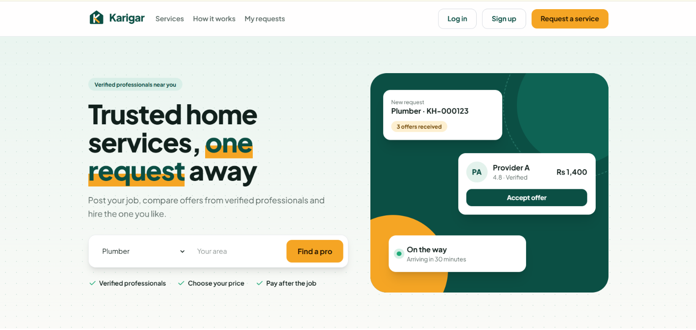
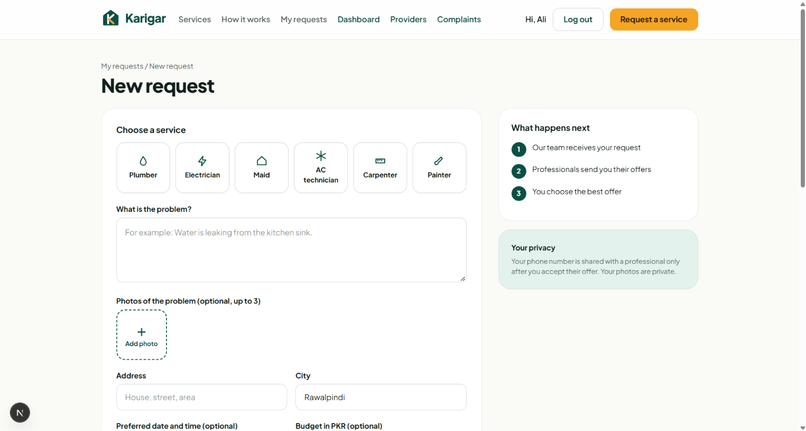
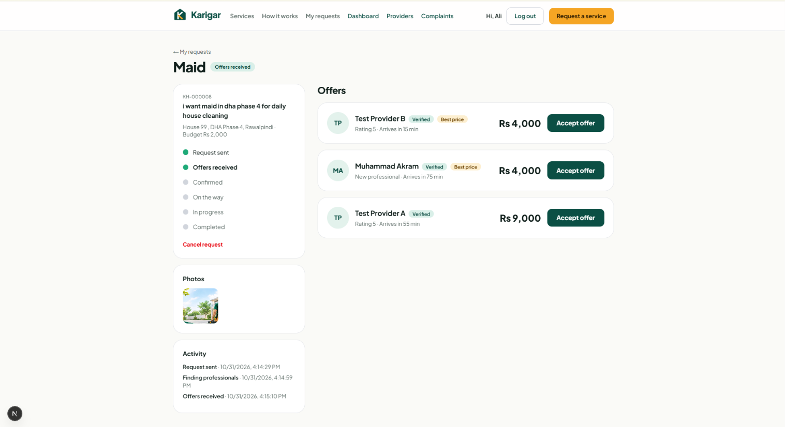
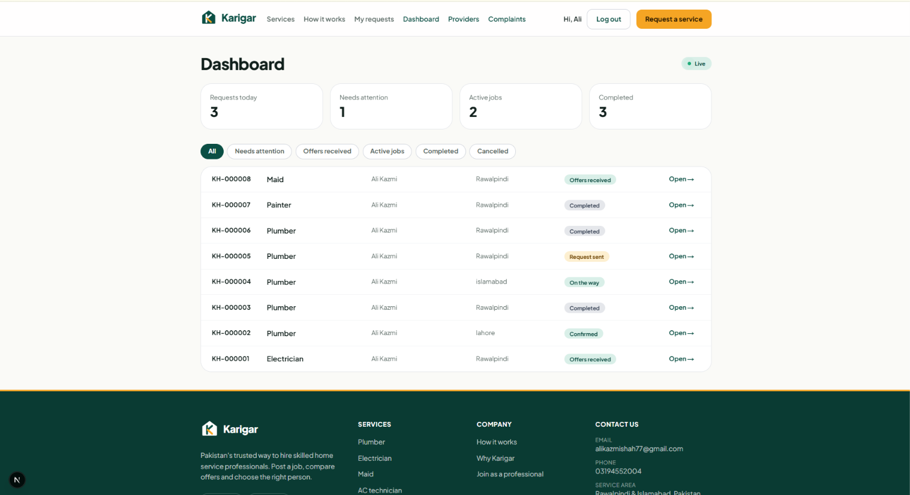
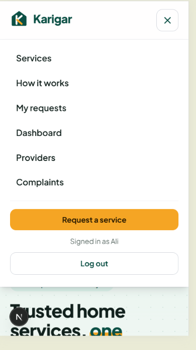

# Karigar

**Hire trusted home service professionals in Pakistan.** Post a job, get offers from verified plumbers, electricians, maids and more, and choose the one you like. Think of it as an inDrive-style marketplace for home services.

**Live demo:** https://karigar-inky.vercel.app

Karigar is a full-stack web app built as a portfolio project. It is designed around a real problem: many skilled workers in Pakistan have limited literacy and smartphone use. So professionals can work from a simple dashboard **or** stay on WhatsApp, and an admin team dispatches the work and fills the gap.



## How it works

1. A customer posts a request (service, problem, address, budget, optional map pin and photos).
2. Verified professionals in that service get an alert. They can send their own price from their dashboard.
3. The admin team also sees the request instantly and can contact other professionals on WhatsApp, then record their prices.
4. The customer gets a notification for every offer, compares them, and accepts or declines.
5. Only the accepted professional receives the address, phone number, map pin and photos.
6. The team updates the job status. The customer follows it live, then rates the professional.

## Features

**Customers**
- Sign up and log in
- Post requests with a map pin, current location and up to 3 photos (compressed in the browser)
- Live notifications and pop-ups when offers arrive
- Accept or decline offers, follow a live job timeline, rate and review, report problems

**Professionals**
- Apply through a form that also creates their login
- Admin verification before they see any job
- Dashboard with open jobs in their services, availability switch, rating and job count
- Send an offer (price and arrival time), withdraw it while pending
- After acceptance: customer name, phone, address, map link and photos

**Admin and dispatchers**
- Live dashboard with filters and request counts
- Dispatch page: suggested verified professionals, pre-filled WhatsApp message, offer recording, status updates
- Professionals page: pending applications first, verify or suspend, link a login to a WhatsApp-only professional
- Alerts for new requests, accepted offers, complaints and new applications
- Complaints management, pinned location and private photos

**Quality**
- Mobile-first responsive design with a mobile menu
- Loading skeletons, spinners and subtle animations (respecting reduced-motion settings)
- Privacy Policy, Terms of Service and Cookie Policy pages

## Screenshots

| New request | Offers |
|---|---|
|  |  |

| Admin dashboard | Dispatch |
|---|---|
|  |  |



## Tech stack

| Area | Technology |
|---|---|
| Framework | Next.js (App Router), React, TypeScript |
| Styling | Tailwind CSS |
| Database | Supabase (PostgreSQL) |
| Auth | Supabase Auth (email and password) |
| Realtime | Supabase Realtime (offers, status, notifications) |
| File storage | Supabase Storage (private bucket, signed URLs) |
| Maps | Leaflet with OpenStreetMap |
| Hosting | Vercel |

## Security

Security was treated as a feature, not an afterthought:

- **Row Level Security** on every table. A customer reads only their own requests, offers, reviews and complaints.
- **Roles** (customer, dispatcher, admin) live in the database. A trigger blocks role changes through the API.
- **Least privilege:** column-level grants and no public access to internal functions, so the API can write only the fields the app uses.
- **Professionals see less before an offer is accepted.** Jobs reach them through database functions that return a summary only. Contact details, map pin and photos are released only to the accepted professional.
- **Private photo storage:** JPEG only, 2 MB limit, short-lived signed URLs, per-user folders and a per-user file cap.
- **Server-side rate limits** (database triggers) on requests, complaints, applications and offers.
- **Validated inputs** in the browser and with database constraints.
- **Safe offer decisions:** accepting or declining runs inside database functions that check ownership.
- **Browser protections:** Content Security Policy, HSTS, `X-Frame-Options`, `nosniff` and a strict referrer policy (production builds).
- Secrets are never committed. Only the public (publishable) Supabase key is used in the browser.

## Known limitations

This is a portfolio project, so some things are intentionally simple:

- Payment is cash only. There is no online payment yet.
- Email confirmation on signup is switched off. Turning it on needs a custom email provider and a domain.
- Notifications are in the app only. There are no push, SMS or WhatsApp messages sent automatically.
- The interface is in English.

## Project structure

```
app/            Pages: home, auth, requests, provider, admin, legal pages
components/     Navbar, notification bell, map and photo pickers, footer, ...
lib/            Supabase client, photo upload, status and format helpers
supabase/       schema.sql (reference database schema)
docs/           SRS, SRS changes and screenshots
```

## Getting started

You need Node.js 20 or newer and a free [Supabase](https://supabase.com) project.

```bash
git clone https://github.com/SyedAliKazmi7/karigar.git
cd karigar
npm install
```

1. Copy `.env.example` to `.env.local`.
2. In your Supabase project, open **Project Settings → API Keys**, then copy the project URL and the publishable key into `.env.local`.
3. Open the Supabase **SQL Editor** and run `supabase/schema.sql`. It is a reference schema for a fresh project: tables, security rules, functions, the private photo bucket and the six service categories.
4. In **Authentication → Sign In / Providers**, switch off "Confirm email" for local testing.
5. Start the app:

```bash
npm run dev
```

Open http://localhost:3000. Sign up, then make your own account an admin by running this once in the SQL editor:

```sql
update profiles set role = 'admin'
where id = (select id from auth.users where email = 'you@example.com');
```

## Documentation

- Full Software Requirements Specification: [`docs/SRS.pdf`](docs/SRS.pdf)
- Changes made after the SRS: [`docs/SRS-v1.1-changes.md`](docs/SRS-v1.1-changes.md)

## Roadmap

- Email confirmation with a custom email provider
- Online payments (JazzCash, Easypaisa)
- Automated WhatsApp messages (WhatsApp Business API)
- Demo mode with sample data
- Urdu interface

## Author

Built by Ali kazmi as a portfolio project.